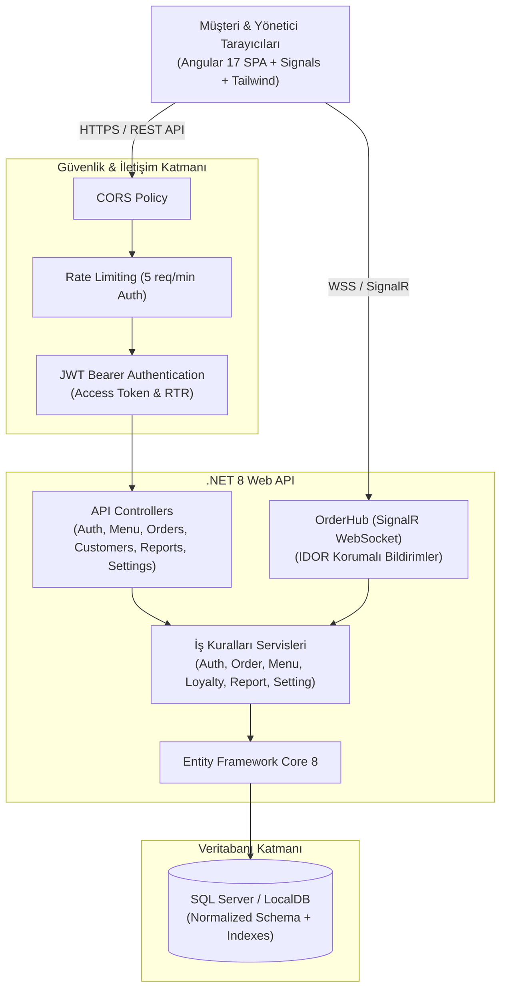
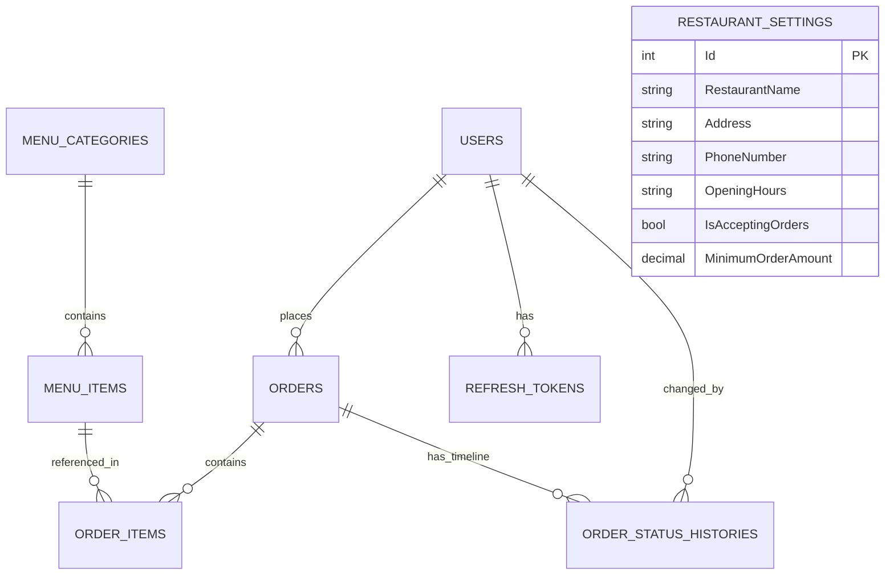

# CafeFlowNet — Sistem Mimarisi ve Tasarım Dokümantasyonu

Bu doküman, CafeFlow restoran ve kafe yönetim platformunun uçtan uca mimarisini, veri modellerini, gerçek zamanlı SignalR altyapısını ve ön yüz tasarım sistemini detaylandırmaktadır.

---

## 1. Genel Sistem Mimarisi

CafeFlow, yüksek performanslı bir .NET 8 Web API arka ucu ve modern, reaktif bir Angular 17 tek sayfa uygulamasından (SPA) oluşan kurumsal bir restoran platformudur.

---

## 2. Arka Yüz (.NET 8 Web API) Katmanları

### 2.1. API & Denetleyici (Controller) Katmanı
- **`AuthController`**: Kullanıcı kaydı, güvenli giriş, profil güncelleme, parola değişimi, refresh token rotasyonu ve oturum kapatma.
- **`MenuController`**: Herkese açık menü listeleme, kategori ve ürün CRUD işlemleri, tekil ürün detayı.
- **`OrderController`**: İdempotent sipariş oluşturma, müşteri sipariş geçmişi, admin sipariş filtreleme (durum, tarih aralığı, müşteri ID), müşteri sipariş iptali.
- **`CustomerController`**: Sadakat müşterisi tanımlama, müşteri arama, hesap durumu aktifleştirme/dondurma, sadakat durumunu kaldırma.
- **`ReportsController`**: Gerçek veritabanı kayıtlarından hesaplanan günlük ciro, sipariş hacmi, ortalama sepet büyüklüğü, en çok satanlar ve kategori dağılımı.
- **`SettingsController`**: Restoran genel ayarları, minimum sipariş tutarı ve anlık sipariş alımını durdurma/açma.

### 2.2. İş Kuralları ve Servis Katmanı
- **Fiyat Manipülasyonu Koruması (`OrderService`)**: İstemciden gelen birim fiyatlar kesinlikle dikkate alınmaz; veritabanındaki güncel `MenuItem.Price` okunur ve toplam tutar sunucuda hesaplanır.
- **İdempotency & Mükerrer Sipariş Önleme**: Müşteri aynı sipariş anahtarı (`IdempotencyKey`) ile art arda istek atarsa yeni kayıt oluşturulmaz, mevcut sipariş döndürülür.
- **Sipariş Durum Otomatı (State Machine)**:
  `Received` (Alındı) ➔ `Preparing` (Hazırlanıyor) ➔ `Ready` (Hazır) ➔ `Completed` (Teslim Edildi)
  - `Cancelled` (İptal) durumuna sadece `Received` aşamasında geçilebilir.
  - Müşteri yalnızca kendi siparişini ve yalnızca `Received` aşamasındayken iptal edebilir.
- **Veri Bütünlüğü ve Soft Delete (`MenuService`)**:
  Daha önce sipariş edilmiş bir ürün silinmek istendiğinde yabancı anahtar (FK) kısıtlamalarını bozmamak adına `IsDeleted = true` işaretlenir; sipariş geçmişi ve raporlar korunurken yeni siparişlerde listelenmez.
- **Token Ailesi ve Yeniden Kullanım Saldırısı Algılama (`AuthService`)**:
  Kullanılmış bir refresh token tekrar sunulursa potansiyel çalınma kabul edilerek o kullanıcının tüm aktif oturumları anında iptal edilir.

---

## 3. Veritabanı Modeli ve İlişkiler (ERD)

### Tablolar ve İndeksleme Stratejisi
1. **`Users`**: `Email` üzerinde tekil (Unique) indeks.
2. **`Orders`**: `CustomerId`, `Status`, `CreatedAt`, `IdempotencyKey` üzerinde sorgu performans indeksleri.
3. **`MenuItems`**: `CategoryId`, `IsAvailable`, `IsDeleted` bileşik indeksleri.
4. **`OrderStatusHistories`**: `OrderId`, `ChangedAt` zaman çizelgesi indeksleri.
5. **`RefreshTokens`**: `TokenHash`, `UserId`, `ExpiresAt` indeksleri.

---

## 4. Gerçek Zamanlı İletişim (SignalR Altyapısı)

`OrderHub` üzerinden canlı sipariş akışı iki taraflı olarak güvenli biçimde yönetilir:

1. **Yönetici Grubu (`admin-orders`)**:
   Yalnızca JWT token'ında `Role = "Admin"` doğrulaması bulunan kullanıcılar bu gruba abone olabilir. Yeni sipariş düştüğünde (`NewOrderReceived`) veya sipariş durumu değiştiğinde (`OrderStatusChanged`) anlık veri fırlatılır.
2. **Müşteri Sipariş Odası (`order-{orderId}`) — IDOR Koruması**:
   İstemci bir siparişi dinlemek istediğinde `OrderHub`, siparişin veritabanındaki `CustomerId` değerini kullanıcının JWT claim'indeki ID ile eşleştirir. Eşleşmiyorsa ve kullanıcı Admin değilse bağlantı kesinlikle odaya eklenmez.
3. **Otomatik Yeniden Bağlanma (Automatic Reconnect)**:
   Angular tarafındaki `SignalRService`, bağlantı koptuğunda üstel geri çekilme (exponential backoff: 0s, 2s, 5s, 10s, 30s) ile yeniden bağlanır.

---

## 5. Ön Yüz Mimarisi (Angular 17)

### 5.1. Bileşen Hiyerarşisi
- **Herkese Açık Modül**: `MenuPageComponent` (Görsel hero, kategori filtresi, hızlı arama, ürün detay modalı, sepet özeti).
- **Kimlik Doğrulama**: `LoginComponent` (Giriş, kayıt olma, tek tıkla demo kullanıcı doldurma).
- **Müşteri Paneli**:
  - `MenuBrowseComponent`: Sadakat müşterisi sipariş menüsü.
  - `CartComponent`: Sepet yönetimi, tahmini varış saati, sipariş notu, idempotent onay.
  - `OrderStatusComponent`: Canlı 4 aşamalı durum çubuğu, SignalR anlık güncellemeleri, müşteri iptal modalı, audit tarihçesi.
  - `OrderHistoryComponent`: Geçmiş siparişler, tek tıkla yeniden sipariş verme (re-order).
  - `ProfileComponent`: Profil bilgileri güncelleme, güvenli parola değişimi.
- **Yönetici Paneli**:
  - `DashboardComponent`: Gerçek verilerle beslenen KPI metrikleri, tarih filtresi, en çok satanlar listesi, kategori satış dağılımı.
  - `OrderManagerComponent`: Canlı Kanban panosu, durum ilerletme butonları, admin sipariş iptali, detay inceleme çekmecesi.
  - `MenuManagerComponent`: Kategori ve ürün yönetimi, inline hızlı fiyat güncelleme, satış durumu anahtarı, güvenli silme.
  - `CustomerManagerComponent`: Sadakat müşterisi ekleme, hesap dondurma/aktifleştirme, arama ve filtreleme.
  - `SettingsManagerComponent`: Restoran bilgileri, min. sepet tutarı, tek tuşla sipariş alımını durdurma/açma.

### 5.2. Tasarım Sistemi ve Erişilebilirlik
- **Tema Motoru (`ThemeService`)**: `localStorage` destekli açık (light) ve koyu (dark) tema desteği (`class="dark"` stratejisi).
- **Bildirim Sistemi (`ToastService`)**: Başarı, hata, uyarı ve bilgi için ekranın sağ üstünde yumuşak animasyonlu toast pencereleri.
- **Tipografi ve İkonografi**: Okunabilir modern font ölçeği, yüksek kontrast oranları (WCAG AA standardı), duyarlı (responsive) grid ve flex düzenleri.
